# Madde — ToS / Contract Trap Spotter

Chrome'da açılan kullanım koşullarını, gizlilik politikasını veya abonelik şartlarını
yakalayıp kaynak alıntılarıyla Türkçe bir risk raporu üretir.
**Bu uygulama hukuki tavsiye vermez.** Gösterge, hukuki geçerlilik veya güvenlik kararı değildir.

## Kurulum

Node.js 24 gerekir. Windows PowerShell'de `npm.ps1` engellenirse aşağıdaki gibi
`npm.cmd` kullanın; yürütme politikasını değiştirmeniz gerekmez.

```powershell
npm.cmd ci
npm.cmd run setup
```

Yerel `.env` dosyasını editörünüzde açıp **GEMINI_API_KEY** değerini oraya girin.
Anahtarı sohbet, kaynak kod, uzantı ayarları veya GitHub'a koymayın.
Varsayılan model: `gemini-3.5-flash-lite`. `PAIRING_TOKEN` rastgele oluşturulur.
API anahtarı ve token farklıdır; uzantıya yalnızca eşleştirme tokenı girilir.

```powershell
git check-ignore .env
npm.cmd run verify:gemini
npm.cmd run build
```

Chrome'da `chrome://extensions` → Geliştirici modu → **Paketlenmemiş öğe yükle**
ile `dist/extension` klasörünü seçin. Görünen uzantı kimliğini `.env` dosyasına
`EXTENSION_ORIGIN=chrome-extension://KIMLIK` olarak yazın. Ardından:

```powershell
npm.cmd run server
```

Bir HTTP/HTTPS politika sayfasını açıp uzantı simgesine tıklayın. İsterseniz önce
sayfadaki bir bölümü seçin. Açılan raporda yakalanan metni kontrol edin,
**Servis bağlantısı** bölümüne `.env` içindeki `PAIRING_TOKEN` değerini girin ve
**Analiz et** seçin. Metin ancak bu son işlemle sağlayıcıya gönderilir.

Tam Gemini yapılandırması, canlı bağlantı kontrolünün anlamı ve hata çözümü:
[docs/gemini-setup.md](docs/gemini-setup.md). Doğrulayıcı anahtarı veya ham API
hatalarını yazdırmaz. Birim testleri ve fixture videosu, canlı API başarısı sayılmaz.

## Mimari ve veri akışı

```mermaid
flowchart LR
  A[Kullanıcı uzantıya tıklar] --> B[İzole içerik betiği: görünür DOM]
  B --> C[Değişmez metin + SHA-256 + önizleme]
  C --> D[Kullanıcı: Analiz et]
  D --> E[127.0.0.1:4318 yerel servis]
  E --> F[Gemini: yapılandırılmış JSON adayları]
  F --> G[Ajv + alıntı + kategori doğrulaması]
  G --> H[Yinelenenleri birleştir + deterministik skor]
  H --> I[Uzantıda yeniden doğrula ve metin olarak göster]
```



| Bölüm                | Sorumluluk                                                                                               |
| -------------------- | -------------------------------------------------------------------------------------------------------- |
| `src/extension/`     | MV3 manifest üretimi, kullanıcı başlatmalı yakalama, arka plan koordinasyonu, rapor ve oturumluk ayarlar |
| `src/analysis/`      | Ortak şemalar, alıntı eşleştirme, kategori kuralları, puanlama ve sunucu tarafı Gemini adaptörü          |
| `src/server/`        | Kimlik doğrulanmış yerel HTTP servisi, Gemini anahtarının kullanıldığı tek çalışma sınırı                |
| `tests/`, `cypress/` | Birim, güvenlik ve gerçek uzantı tarayıcı senaryoları                                                    |
| `eval/`              | Gerçek kaynaklar, önceden dondurulmuş alıntılı etiketler ve canlı sonuçlar                               |

Yakalama görünür ana metin/article bölgesini, yoksa görünür sayfa gövdesini kullanır.
URL sorgusu ve fragment kaldırılır. Metin, başlık, zaman, kapsam ve hash birlikte
saklanır; sonraki sayfa değişiklikleri raporun kaynağını değiştirmez.
Uzun LLM isteği rapor sekmesinden yapılır; service worker'ın uyanık kalmasına dayanmaz.

`POST /v1/analyze`, `{ snapshot }` alır. Rapor; sürüm, snapshot hash'i, durum,
işlenen metin oranı, skor veya `null`, doğrulanmış bulgular, reddedilen aday sayısı
ve uyarılar içerir. Her bulgu kategori, tam özgün paragraf, UTF-16 karakter
aralığı, Türkçe başlık/açıklama ve sabit ağırlık taşır. Anahtar bu arayüzde yoktur.

### Alibaba page-agent

Gerçek [Alibaba page-agent](https://github.com/alibaba/page-agent) DOM çıkarıcısı
v1.12.4, `9eb6b6646500264d9034dd466a4270cb9fc1ef1e` commit'inden alınmıştır.
MIT lisansı, özgün hash'ler ve uyarlamalar vendor klasöründe tutulur.
Bu entegrasyon salt okunur DOM bileşenlerini kullanır; tam özerk PageAgent döngüsü değildir.

Metin düğümlerine özgün DOM referansları eklendi; form/editable alanlar,
çerçeveler ve gizli alt ağaçlar elenir, nitelik toplama kapalıdır. Vurgulama
kapalı çalışır. Aksiyonlar, JavaScript çalıştırıcı ve demo LLM istemcisi alınmaz.
CDN veya uzaktan çalıştırılan kod yoktur. Üretim paketi yalnızca `activeTab`,
`scripting`, `storage` ve sabit loopback servisi erişimini ister.

### Kanıt ve puanlama

Model yalnızca kategori, alıntı ve parça kimliği önerir. Skoru, hukuki sonucu
ve kullanıcıya gösterilen açıklamayı model yazmaz. Google'ın üretim şeması
uyumlu alt kümeyi kullanır; **tam yerel Ajv şeması** ek alanları, türleri,
uzunlukları ve sınırları ayrıca zorunlu tutar. Serbest metin/JSON onarımı yapılmaz.

Alıntı kaynakta bulunmalı, anlamlı tam paragrafı kapsamalı ve kategori kuralından
geçmelidir. Sadece boşluk farklılıkları eşleştirilir; özgün karakterlere dönülür.
Bulanık eşleştirme veya alıntısız iddia kabul edilmez. Tekrarlanan alıntı ve
kategoriler skoru şişirmez. Açıklamalar sürümlü Türkçe kategori şablonlarıdır.

| Kategori                                                          |     Ağırlık |
| ----------------------------------------------------------------- | ----------: |
| Otomatik yenileme; denemeden ücretliye geçiş; iade kısıtı         | Her biri 10 |
| İptal kısıtı                                                      |          15 |
| Tek taraflı değişiklik; üçüncü taraf paylaşımı; reklam/profilleme | Her biri 10 |
| Uzun saklama                                                      |           5 |
| Zorunlu tahkim; toplu dava feragati                               | Her biri 10 |

Skor farklı tespit edilen kategorilerin toplamıdır, 0–100 aralığındadır.
Ağırlıklar bu ödevin göstergesidir; ölçülmüş hukuki risk olasılığı değildir.
Durumlar `complete`, `partial`, `inconclusive`, `error` olarak ayrılır.
Başarısız/belirsiz analizde skor `null` olur; destekli bulgusu bulunan eksik
analizde gözlenen skor “Eksik analiz” etiketiyle gösterilir.
Tam analizde sıfır puan “doğrulanmış risk bulunamadı” demektir; güvenli sözleşme anlamına gelmez.

Sınırlar: 200.000 kaynak karakteri, 20.000 karakterlik parçalar ve en fazla
1.000 karakter örtüşme, en fazla 12 parça, iki eşzamanlı sağlayıcı çağrısı,
çağrı başına 45 saniye, analiz başına üç dakika. Kesilerek metin kaybedilmez.
İşlenen oran örtüşen aralıkları iki kez saymaz. Ücretsiz Gemini kotası dolarsa
uyarı gösterilir; otomatik tekrar, ücretli modele geçiş veya faturalandırma değişikliği yapılmaz.

## Güvenlik ve sınırlar

- Sayfa metni güvenilmeyen veridir; modelin aracı, sayfa kontrolü veya URL getirme yetkisi yoktur. Sağlayıcı adresi sabittir.
- Yerel servis yalnızca `127.0.0.1:4318` üzerinde dinler; tam Host, izinli uzantı Origin'i ve tokenı doğrular. İstek boyutu, hız ve eşzamanlı analiz sınırları vardır.
- API anahtarı yalnızca Node sürecinde kullanılır, `x-goog-api-key` başlığındadır. URL'ye, uzantıya veya loga yazılmaz. `.env` derlemeye kopyalanmaz.
- Ajv doğrulayıcıları derleme sırasında üretilir; uzantıda `eval` veya `new Function` gerektirmez. Sayfa/LLM metni `textContent` ile gösterilir.
- Token ve kaynak extension session storage içindedir; raporlar yalnızca açık sekmenin belleğinde tutulur ve sayfa yenilenince yeniden analiz gerekir. “Oturum verilerini sil” tüm açık rapor sekmelerini geçersiz kılar ve devam eden istekleri durdurur. Sunucu varsayılan olarak metin/yanıt geçmişi tutmaz.
- PDF, OCR, çerçeveler, gölge DOM içeriği, kapalı bölümleri açma ve bağlantılı sayfaları tarama bu sürümde yoktur. Gizli içerik filtrelemesi tüm CSS hilelerini garanti etmez.
- Talimat benzeri metin uyarısı yardımcıdır; güvenlik sınırı değildir. Model saldırı nedeniyle bir maddeyi atlayabilir. Eşleşen bir alıntı da yorumun hukuken doğru olduğunu kanıtlamaz.

## Komutlar ve doğrulama

`npm.cmd run audit:secrets`, yerel anahtarın kaynak/paket/artifaktlarda bulunmadığını
ve `.env` Git dışlamasını ayrıca denetler; anahtarın kendisini yazdırmaz.

| Komut                         | İşlev                                                                                                           |
| ----------------------------- | --------------------------------------------------------------------------------------------------------------- |
| `npm.cmd run dev`             | Derle, yerel servisi başlat, uzantı kaynak değişikliklerinde yeniden derle; Chrome'da uzantıyı yeniden yükleyin |
| `npm.cmd run build`           | Üretim ve ayrı otomasyon paketleri                                                                              |
| `npm.cmd run server`          | Gerçek Gemini kullanan yerel servis                                                                             |
| `npm.cmd run verify:gemini`   | Gerçek API, şema, alıntı, skor ve hata doğrulaması                                                              |
| `npm.cmd run test:unit`       | Vitest kanıt, puan, servis, Gemini ve eval eşleştirme testleri                                                  |
| `npm.cmd run typecheck`       | TypeScript kontrolü                                                                                             |
| `npm.cmd run lint`            | ESLint                                                                                                          |
| `npm.cmd run format:check`    | Prettier                                                                                                        |
| `npm.cmd run browser:install` | Test için Chrome for Testing/Chromium indir                                                                     |
| `npm.cmd run test:e2e`        | Cypress gerçek uzantı senaryoları; fixture sağlayıcı                                                            |
| `npm.cmd run demo:record`     | Gerçek raporu gösteren ≤90 sn Cypress videosu                                                                   |
| `npm.cmd run eval`            | Dondurulmuş beş gerçek politika örneğiyle canlı Gemini eval                                                     |

E2E çalıştırmak için önce `npm.cmd run browser:install` çalıştırın; 4318 ve 4319
portlarını boş bırakın. `dist/test-extension`, yalnızca otomasyonda localhost
erişimi ve raporu localhost iframe'inde gösterebilmek için ek izinler taşır.
**Chrome'a günlük kullanım için `dist/extension` yükleyin.**

Cypress CDP köprüsü gerçek yakalama/mesajlaşma/rapor kodunu çalıştırır. Gerçek
uzantı raporu localhost test çerçevesinde görünür; kayıt demo sayfasının yeniden
uygulanmış bir arayüzünü kullanmaz. Cypress'in ölçekli çapraz-origin çerçevesinde
kontrollerin DOM aktivasyonu kullanılır. Bu yöntem toolbar tıklamasını veya
üretim `activeTab` iznini tek başına doğrulamaz.

Elle smoke testi: üretim paketini normal Chrome'a yükle, bir politika sayfasında
toolbar simgesine tıkla, önizlemeyi doğrula, servisle analiz et, alıntıya dön,
sonra `chrome://extensions` gibi kısıtlı bir sayfada anlaşılır hata ekranını kontrol et.
Bu elle adımların gerçekten yapıldığını test sonuçlarından çıkarmayın.

Video `artifacts/videos/demo.cy.cjs.mp4` dosyasına kaydedilir. Mutlu yolda
doğrulanmış alıntı, ikinci analizde sahte alıntının reddi ve boş skor gösterilir.
Kayıt kontrollü yanıt kullandığını açıkça belirtir; canlı Gemini eval değildir.
Güvenlik testleri gizli ve görünür enjeksiyonları, bozuk JSON'u, alıntı uyuşmazlığını,
form verisi dışlamayı ve metin olarak güvenli gösterimi kapsar.

## Beş gerçek metin üzerinde eval

Kaynaklar Spotify ücretli abonelik şartları, Google Türkçe gizlilik politikası,
Dropbox şartları, GitHub şartları ve Mozilla Firefox şartlarıdır. Discord
sertifika doğrulaması başarısız olduğu için yerine Mozilla alınmıştır; TLS
kontrolü kapatılmamıştır. Kaynak URL, tarih, dil ve hash her metnin JSON dosyasındadır.

Tam yakalanan metinler `eval/sources/` içinde; seçilmiş özgün paragraflar ve
önceden dondurulmuş etiketler `eval/annotations/` içindedir. Eval bütün politikayı
değil, açıkça belirtilen bu paragrafları ölçer. Etiketler asistan kaynak incelemesiyle
hazırlanmıştır; hukuk uzmanı incelemesi değildir. Her alıntının tam kaynak aralığı saklanır.

Bir TP aynı kategoride etiketli maddeyle örtüşen, kanıtı doğrulanmış bir bulgudur.
Eşleştirme bire birdir. Eşleşmeyen bulgu FP, eşleşmeyen pozitif etiket FN'dir.
Belirsiz etiketler ayrı raporlanır. Sonuçlar [eval/RESULTS.md](eval/RESULTS.md)
ve `eval/results/live.json` içinde TP/FP/FN, precision/recall, kapsam, reddedilen
adaylar ve örnek hatalarla tutulur. Fixture yanıtları canlı metrik üretmek için kullanılmaz.

Mevcut canlı çalıştırma: **5/5 başarılı Gemini isteği; 7 yakalanan, 9 kaçırılan,
0 yanlış alarm; recall %43,8.** Bu sonuçlar değiştirilmeden teslim edilmiştir.

## Teslim

Repo içeriğine README, kaynak kod, testler, eval kaynak/etiket/sonuçları ve
page-agent lisansı dahildir. **67,24 saniyelik Cypress demo videosu**
[demo/demo.mp4](demo/demo.mp4) dosyasındadır; GitHub önizlemesi açılmazsa dosyayı
indirip oynatın. Video başarılı analiz ve dürüst belirsizlik gösterir; kontrollü
yanıtlar kullanır. Yeniden kaydetmek için `npm.cmd run demo:record` çalıştırın;
çıktı `artifacts/videos/demo.cy.cjs.mp4` olur. Süre kontrolü Chrome'da gerçek MP4
metadatasını doğrular. [Doğrulama kayıtları](demo/README.md) ayrıca teslim edilmiştir.

`.env`, API anahtarı, eşleştirme tokenı, bağımlılıklar, derleme çıktıları ve
hassas loglar repo dışında tutulur. Yukarıdaki kurulumla kendi yerel `.env`
dosyanızı oluşturun. Teslimde GitHub repo bağlantısını üniversite sistemine girin.
